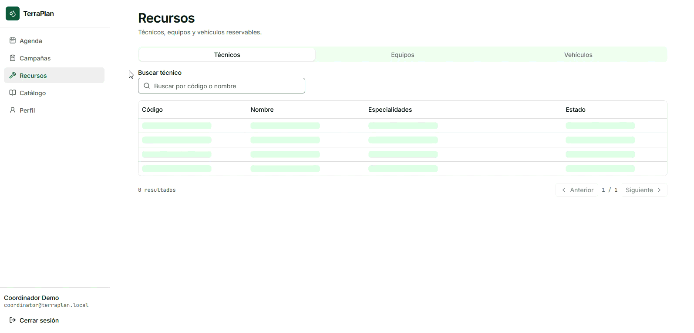

# TerraPlan

[](https://github.com/criverap-duoc/TerraPlan/actions/workflows/ci.yml)
[](https://nestjs.com)
[](https://react.dev)
[](LICENSE)
[](https://terraplan-api.onrender.com/api/v1/health)
[](https://terraplan.vercel.app)


Agenda de campañas de muestreo ambiental: calcula ventanas factibles según los tiempos de
conservación de cada parámetro, reserva técnico + equipo + vehículo de forma atómica y reprograma
cuando el clima o el caudal no permiten muestrear.

## Sobre el proyecto

Coordinar una campaña de muestreo es un problema de tiempos que se cruzan: la muestra debe llegar al
laboratorio antes de que se degrade, el técnico, el equipo y la camioneta tienen que estar libres al
mismo tiempo, y el clima o el caudal pueden arruinar el viaje la mañana anterior. TerraPlan ordena
ese trabajo: el coordinador elige sitio y parámetros, el sistema calcula las **ventanas factibles**
con los tiempos de conservación del catálogo compartido, reserva los tres recursos en una sola
transacción y deja cada cambio en una bitácora.

Lo usan técnicos de terreno desde el móvil (marcar una campaña en terreno), coordinadores de
laboratorio (planificar y reprogramar) y gestores ambientales (revisar qué se muestreó y con qué
límites). La reserva de recursos **no puede** fallar por doble booking: la garantía vive en un
`EXCLUDE USING gist` de PostgreSQL, no en una validación de aplicación que dos usuarios pueden
esquivar a la vez. Los resultados se publican después a [AquaMetric](https://github.com/criverap-duoc),
el proyecto hermano en FastAPI, contra el mismo catálogo versionado.

El MVP se construyó en tres semanas como rebanadas verticales (de la migración a la pantalla) y se
despliega completo en free tiers. Las decisiones están documentadas como ADRs y el glosario está
escrito para el químico que valida los límites normativos.

## Stack

| Capa | Tecnología |
|---|---|
| Runtime | Node.js 24 + TypeScript |
| API | NestJS 12 · TypeORM 0.3 (PostgreSQL 16) · Mongoose (MongoDB) |
| Auth | JWT + Passport + argon2 |
| Frontend | React 19 · Vite · Tailwind 4 · shadcn/ui · TanStack Query |
| Infra | Docker Compose · GitHub Actions · Render / Neon / Atlas / Vercel |

## Quickstart

```bash
pnpm install
docker compose up -d postgres mongo
cp api/.env.example api/.env
pnpm --filter api migration:run
pnpm --filter api seed:all
pnpm --filter api start:dev
cp web/.env.example web/.env
pnpm --filter web dev
curl http://localhost:3000/api/v1/health
```

- API: `http://localhost:3000/api/v1` · Health: `GET /api/v1/health` · Swagger: `http://localhost:3000/docs`
- Web: `http://localhost:5173` (login con las cuentas demo del seed, ej. `coordinator@terraplan.local`)
- PostgreSQL: `localhost:5432` (contenedor `terraplan-pg`)
- MongoDB: `localhost:27017` (contenedor `terraplan-mongo`)

## Estado de las rebanadas

| # | Rebanada | Estado |
|---|---|---|
| R1 | Scaffold del monorepo, Docker Compose, config validado, health y CI | ✅ |
| R2 | Catálogo compartido (lectura) | ✅ |
| R3 | Auth + roles (JWT, refresh rotativo) | ✅ |
| R4 | Sitios y recursos (técnicos, equipos, vehículos) | ✅ |
| R5 | Reserva atómica + test de carrera | ✅ |
| R6 | Ventanas factibles | ✅ |
| R7 | Campañas y máquina de estados | ✅ |
| R8 | Weather/flow gate + reprogramación | ✅ |
| R9 | Log de eventos en MongoDB | ✅ |
| R10 | Publicación a AquaMetric | ✅ |
| R11 | Pantallas del MVP (frontend) | ✅ login, agenda, campañas, detalle, asistente de nueva campaña, recursos y catálogo |
| R12 | k6, deploy free tier y documentación final | ✅ k6 (carrera y lectura), `render.yaml`, `api/Dockerfile`, arquitectura, glosario, ADRs y guía de despliegue |

## Capturas

### Login - Agenda - Campañas


### Recursos - Catálogo - Perfil - Logout



## Auth

JWT con access token de 15 min y refresh token rotativo de 7 días (se guarda solo el hash en
PostgreSQL y es revocable). **Deny-by-default:** todo endpoint exige
`Authorization: Bearer <access>` salvo los marcados con `@Public()` (health, catálogo, login y refresh).

| Acción | admin | coordinator | field_technician | viewer |
|---|---|---|---|---|
| Ver agenda/campañas | ✓ | ✓ | ✓ (las suyas) | ✓ |
| Crear/reservar/reprogramar campaña | ✓ | ✓ | — | — |
| Marcar en terreno / completar | ✓ | ✓ | ✓ (las suyas) | — |
| CRUD recursos y sitios | ✓ | ✓ | — | — |
| Gestión de usuarios | ✓ | — | — | — |

```bash
# Login: 200 + accessToken + refreshToken
curl -X POST http://localhost:3000/api/v1/auth/login \
  -H 'Content-Type: application/json' \
  -d '{"email":"coordinator@terraplan.local","password":"Coord1234!"}'

# Perfil: 200 + role
curl http://localhost:3000/api/v1/auth/me -H 'Authorization: Bearer <accessToken>'

# Rotar el par: el refresh anterior queda revocado y su reutilización devuelve 401
curl -X POST http://localhost:3000/api/v1/auth/refresh \
  -H 'Content-Type: application/json' -d '{"refreshToken":"<refreshToken>"}'
```

- `pnpm --filter api seed:users` crea un usuario por rol (`admin@`, `coordinator@`, `technician@` y
  `viewer@terraplan.local`; contraseñas demo en `api/src/database/seeds/initial-users.ts`). Es solo
  para desarrollo: en producción los usuarios se crean con un script manual y contraseñas propias.
- `JWT_ACCESS_SECRET` y `JWT_REFRESH_SECRET` deben ser distintos, aleatorios y de ≥ 32 caracteres.
  En producción se rotan y nunca se commitean.
- `/auth/login` y `/auth/refresh` aceptan 5 intentos por minuto por IP; el sexto responde 429.
- `pnpm --filter api test:e2e` requiere PostgreSQL arriba (`docker compose up -d postgres`) y la
  migración aplicada; si la BD no responde, el test falla con un mensaje explícito (no se salta).

## Sitios y recursos reservables

| Recurso | Campos principales | Notas |
|---|---|---|
| Sitio (`site`) | `code` (único), `name`, `waterBodyType`, `latitude`/`longitude`, `isActive` | Coordenadas WGS84 en `numeric(9,6)`; `waterBodyType`: `river`, `lake`, `estuary`, `groundwater`, `effluent`, `drinking` |
| Técnico (`technician`) | `code` (único), `fullName`, `phone`, `skills[]`, `userId?`, `isActive` | `userId` debe ser un usuario activo con rol `field_technician` |
| Equipo (`equipment`) | `code` (único), `name`, `category`, `serialNumber?`, `isActive` | `category` es texto libre por ahora (ej. `multiparametric_probe`) |
| Vehículo (`vehicle`) | `code` (único), `name`, `plate` (única), `capacityKg?`, `isActive` | `capacityKg` entero > 0 |

La lectura es pública; la escritura requiere `admin` o `coordinator` y la baja lógica solo `admin`.
Los listados devuelven `{ data, meta: { page, pageSize, total } }` (paginación 1–100, `sort`/`order`).

| Método | Ruta | Rol | Descripción |
|---|---|---|---|
| GET | `/api/v1/sites` | público | Lista con filtros `waterBodyType`, `isActive`, `q` y orden `code`/`name`/`createdAt` |
| GET | `/api/v1/sites/:id` | público | Detalle de un sitio |
| POST | `/api/v1/sites` | admin, coordinator | Crea un sitio (409 si el `code` ya existe) |
| PATCH | `/api/v1/sites/:id` | admin, coordinator | Actualiza un sitio |
| DELETE | `/api/v1/sites/:id` | admin | Baja lógica (`isActive=false`), responde 204 |
| GET | `/api/v1/technicians` | público | Lista con filtros `isActive`, `q` y orden `code`/`fullName`/`createdAt` |
| GET | `/api/v1/technicians/:id` | público | Detalle de un técnico |
| POST | `/api/v1/technicians` | admin, coordinator | Crea un técnico (409 por `code`; 400 si el `userId` no es `field_technician`) |
| PATCH | `/api/v1/technicians/:id` | admin, coordinator | Actualiza un técnico |
| DELETE | `/api/v1/technicians/:id` | admin | Baja lógica, responde 204 |
| GET | `/api/v1/equipment` | público | Lista con filtros `isActive`, `q` y orden `code`/`name`/`category`/`createdAt` |
| GET | `/api/v1/equipment/:id` | público | Detalle de un equipo |
| POST | `/api/v1/equipment` | admin, coordinator | Crea un equipo (409 por `code`) |
| PATCH | `/api/v1/equipment/:id` | admin, coordinator | Actualiza un equipo |
| DELETE | `/api/v1/equipment/:id` | admin | Baja lógica, responde 204 |
| GET | `/api/v1/vehicles` | público | Lista con filtros `isActive`, `q` y orden `code`/`name`/`plate`/`createdAt` |
| GET | `/api/v1/vehicles/:id` | público | Detalle de un vehículo |
| POST | `/api/v1/vehicles` | admin, coordinator | Crea un vehículo (409 por `code` o `plate`) |
| PATCH | `/api/v1/vehicles/:id` | admin, coordinator | Actualiza un vehículo |
| DELETE | `/api/v1/vehicles/:id` | admin | Baja lógica, responde 204 |
| GET | `/api/v1/users` | admin | Lista paginada de usuarios (sin `passwordHash`), filtro `role` y búsqueda `q` |

## Reserva atómica

El corazón del proyecto (ADR-001). Reservar técnico + equipo + vehículo son **tres `INSERT` en una
sola transacción** contra `resource_booking`, y la BD impide el doble booking con un
`EXCLUDE USING gist (resource_id WITH =, during WITH &&) WHERE (status = 'active')` sobre un
`tstzrange` semiabierto `[start, end)`. Si cualquiera de los tres choca, PostgreSQL responde
SQLSTATE `23P01`, el repository lanza `ResourceConflictError` y el filtro global devuelve **409**
`application/problem+json` con `code: RESOURCE_CONFLICT` y el nombre legible del recurso
(ej. `El vehículo VH-01 ya está reservado en ese horario.`). Los rangos consecutivos no chocan
(`[10:00,12:00)` + `[12:00,14:00)` es válido) y `DELETE` libera las reservas (`status='released'`)
sin borrar la fila, que queda como auditoría.

| Método | Ruta | Rol | Descripción |
|---|---|---|---|
| POST | `/api/v1/campaigns/:campaignId/reservations` | admin, coordinator | Reserva triple atómica; 409 si algún recurso se solapa |
| GET | `/api/v1/campaigns/:campaignId/reservations` | admin, coordinator, field_technician | Reservas activas de la campaña |
| DELETE | `/api/v1/campaigns/:campaignId/reservations` | admin, coordinator | Libera las reservas activas (204) |

Validaciones del servicio antes de tocar la BD: `startsAt < endsAt`, duración ≤ 24 h, ventana no
terminada, campaña existente y en estado `draft` o `planned` (desde R7), y los tres recursos activos.
La garantía anti-doble-booking **no** es "consultar y luego insertar": es el constraint.

```bash
pnpm --filter api test:int   # Testcontainers: postgres:16-alpine efímero, requiere Docker
pnpm --filter api test:e2e   # HTTP completo contra el Postgres de docker compose
```

`test:int` levanta un PostgreSQL efímero con Testcontainers porque el test de carrera necesita
**concurrencia real** (10 reservas simultáneas ⇒ 1 éxito y 9 conflictos) y no debe tocar los datos de
desarrollo. `test:e2e` usa el Postgres de `docker compose` (ya migrado) para probar endpoints, roles
y el body `problem+json`, igual que las rebanadas anteriores.

## Ventanas factibles

`POST /api/v1/campaigns/:campaignId/feasible-windows` divide el rango pedido en slots consecutivos y,
para cada uno, calcula si la muestra alcanza a analizarse antes de que venza el **tiempo de
conservación** más corto de los parámetros elegidos (`holdingTimeHours` del catálogo). Es
**informativo**: no persiste nada ni reserva recursos (la garantía real es el `EXCLUDE` descrito
arriba).

Para cada slot: `arrivalAtLab = samplingEnd + transportMinutes`; si el laboratorio está cerrado,
`analysisStart` se corre a la próxima apertura (en R6: 8:00–18:00, lunes a viernes,
`America/Santiago`). La ventana es factible solo si `analysisStart ≤ holdingDeadline`, donde
`holdingDeadline = samplingEnd + minHoldingTimeHours`. Si todos los parámetros son `in_situ`,
`minHoldingTimeHours` es `"Infinity"` y todas las ventanas son factibles. Se devuelven como máximo
100 ventanas (las primeras), ordenadas por `samplingStart`.

```bash
curl -X POST http://localhost:3000/api/v1/campaigns/<campaignId>/feasible-windows \
  -H 'Authorization: Bearer <access_token>' -H 'Content-Type: application/json' \
  -d '{"earliestStart":"2026-11-16T13:00:00Z","latestEnd":"2026-11-20T22:00:00Z",
       "slotMinutes":120,"transportMinutes":90,"parameterCodes":["TURB","N_NO3"]}'
```

| Método | Ruta | Rol | Descripción |
|---|---|---|---|
| POST | `/api/v1/campaigns/:campaignId/feasible-windows` | admin, coordinator | Calcula ventanas factibles; 404 si la campaña no existe |

La regla vive en `computeFeasibleWindows()` (`scheduling/compute-feasible-windows.domain.ts`): función
pura, sin Nest, sin TypeORM y sin `new Date()`; usa `Intl` para la zona horaria y tiene tests de tabla
(factible simple, cierre del laboratorio, fin de semana, cruce de medianoche, `Infinity`, múltiples
slots y rango vacío). Ver `01 §4.2` y [`docs/architecture.md`](docs/architecture.md).

## Campañas

Una campaña nace en `draft` con un sitio, una lista de parámetros del catálogo y, opcionalmente, una
fecha de inicio temprana. Su ciclo de vida está en una función pura
(`campaigns/campaign-status.domain.ts`, tabla de 49 combinaciones) y cada transición valida sus
precondiciones antes de escribir en la BD.

| Desde | Hacia | Precondición |
|---|---|---|
| `draft` | `planned` | Al menos una ventana guardada |
| `draft` | `cancelled` | Motivo (la API `DELETE` usa un motivo por defecto) |
| `planned` | `confirmed` | Al menos una reserva activa |
| `planned` | `draft` | — (volver a editar) |
| `planned` | `cancelled` | Motivo |
| `confirmed` | `in_field` | Una ventana seleccionada |
| `confirmed` | `needs_reschedule` | Motivo; libera las reservas activas |
| `confirmed` | `cancelled` | Motivo; libera las reservas activas |
| `in_field` | `completed` | — |
| `in_field` | `cancelled` | Motivo; libera las reservas activas |
| `needs_reschedule` | `planned` | Al menos una ventana guardada |
| `needs_reschedule` | `cancelled` | Motivo; libera las reservas activas |
| `completed` | `cancelled` | Motivo; libera las reservas activas |

Cualquier otro par responde **409** `INVALID_STATE_TRANSITION`. Las precondiciones incumplidas
responden **400** con código estable: `NO_WINDOW_SELECTED`, `NO_ACTIVE_RESERVATION`,
`NO_SELECTED_WINDOW`, `REASON_REQUIRED` o `UNKNOWN_PARAMETER`.

| Método | Ruta | Rol | Descripción |
|---|---|---|---|
| GET | `/api/v1/campaigns` | todos | Lista paginada; filtros `status`, `siteId`, `from`, `to` |
| GET | `/api/v1/campaigns/:id` | todos | Detalle con sitio, parámetros, ventanas y `hasActiveReservations` |
| POST | `/api/v1/campaigns` | admin, coordinator | Crea en `draft`; 400 si un parámetro no existe en el catálogo |
| PATCH | `/api/v1/campaigns/:id` | admin, coordinator | Solo en `draft`: `notes`, `earliestStart`, `parameterCodes` |
| POST | `/api/v1/campaigns/:id/transition` | admin, coordinator | Aplica la máquina de estados |
| POST | `/api/v1/campaigns/:id/windows` | admin, coordinator | Reemplaza las ventanas (`draft` o `planned`) |
| POST | `/api/v1/campaigns/:id/select-window` | admin, coordinator | Marca una ventana como seleccionada |
| DELETE | `/api/v1/campaigns/:id` | admin | Cancela y libera reservas (204, idempotente) |

Flujo típico: crear → calcular ventanas factibles → guardar ventanas → seleccionar una → reservar
técnico + equipo + vehículo → `planned` → `confirmed` → `in_field` → `completed`. Si el clima o el
caudal obligan a reprogramar: `confirmed → needs_reschedule` (libera reservas) → `planned`.

## Weather / flow gate

`POST /api/v1/campaigns/:campaignId/check-weather` (admin, coordinator) evalúa la campaña contra el
pronóstico y el caudal:

1. Usa la ventana seleccionada; si no hay ninguna, evalúa todas las ventanas guardadas.
2. Pide el pronóstico horario a **Open-Meteo** (sin API key, timeout 5 s, 1 reintento con backoff
   500 ms) y el caudal al `FlowProvider` simulado (determinístico entre 0,5 y 50,5 m³/s).
3. `assessWeather` (función pura) compara la **precipitación máxima** de la ventana y el caudal
   contra los umbrales globales (`5 mm/h`, `0,1–100 m³/s`). Prioridad del motivo:
   `precipitation_exceeded` → `flow_too_low` → `flow_too_high`.
4. Si no es factible y la campaña está `confirmed`, se transiciona automáticamente a
   `needs_reschedule` con el motivo en `notes` y se liberan las reservas activas.
   En cualquier otro estado solo se reporta (`transitioned: false`).

Respuesta: `{ campaignId, allFeasible, transitioned, assessments[] }`, con la precipitación y el
caudal usados en cada ventana. Sin ventanas → **400** `NO_WINDOWS_TO_CHECK`; fallo del proveedor →
**502** `UPSTREAM_UNAVAILABLE`. Los umbrales son globales en R8 (parametrizables por sitio en R12).

## Eventos de campaña (MongoDB)

Cada operación relevante deja un documento **append-only** en la colección `campaign_events` de
MongoDB. Cumple el patrón **best-effort post-commit** ([ADR-002](docs/adr/002-mongo-events.md)):
el evento se escribe **después** del commit de PostgreSQL y, si falla, la operación de negocio igual
se responde con éxito. El log es auditoría operativa, **no** fuente de verdad; los documentos
expiran a los **90 días** (índice TTL sobre `at`).

| Tipo | Cuándo se emite |
|---|---|
| `created` | Se crea una campaña |
| `status_changed` | Cualquier transición de estado (incluye `from`, `to` y `reason`) |
| `booking_created` | Se reservan técnico + equipo + vehículo |
| `booking_released` | Se liberan las reservas activas |
| `weather_blocked` | El chequeo de clima/caudal obliga a reprogramar |
| `cancelled` | Se cancela una campaña |
| `rescheduled` | Reservado para una rebanada futura (la reprogramación actual se audita con `weather_blocked` + `status_changed`) |
| `observations_published` | El lote se publicó con éxito en AquaMetric (incluye `catalogVersion`, `siteCode`, `observationCount` e `idempotencyKey`) |

`GET /api/v1/campaigns/:campaignId/events` (admin, coordinator, field_technician, viewer) devuelve
los eventos más recientes primero, con filtros `type`, `before` (cursor ISO-8601) y `limit`
(1–200, por defecto 50):

```json
{
  "data": [
    {
      "id": "6712f0c1a4b8e9d2c3f4a5b6",
      "campaignId": "0f5b7c9e-2a4d-4c8e-9b1f-3d5e7a9c1b2d",
      "type": "status_changed",
      "payload": { "from": "draft", "to": "planned", "reason": null },
      "actorId": "9f8e7d6c-5b4a-4938-8271-6a5b4c3d2e1f",
      "requestId": "c1a2b3c4-d5e6-4f70-8a9b-0c1d2e3f4a5b",
      "at": "2026-11-16T13:05:00.000Z"
    }
  ],
  "meta": { "count": 1, "nextCursor": null }
}
```

`EventsService.record` reintenta una vez (500 ms de backoff) y nunca lanza: si ambos intentos fallan
registra el error con `requestId` y `campaignId`, y la respuesta HTTP no cambia.

## Integración con AquaMetric (R10)

`POST /api/v1/campaigns/:campaignId/publish` (admin, coordinator) envía el lote de la campaña al
proyecto hermano **AquaMetric**: `POST {AQUAMETRIC_URL}/api/v1/ingest/observations` con `X-API-Key`
e `Idempotency-Key`. El contrato de los datos es el del catálogo compartido
([`catalog/schemas`](catalog/schemas)).

| Método | Ruta | Rol | Descripción |
|---|---|---|---|
| POST | `/api/v1/campaigns/:campaignId/publish` | admin, coordinator | Construye y publica el lote; 404 si la campaña no existe |

Reglas del lote:

1. Solo campañas en `in_field` o `completed`; el resto responde **400** `PUBLISH_INVALID_STATE`.
2. Se usa la **ventana seleccionada** (o la primera guardada) para fechar el muestreo; sin ventanas →
   **400** `NO_WINDOW_TO_PUBLISH`.
3. Un `Sample` (matriz `water`, `status: analyzed`) con `collectedAt` = fin de la ventana y
   `labReceivedAt` = `collectedAt` + `transportMinutes`; una `Observation` por parámetro de la
   campaña, con `unitCode` canónico y `method` tomados del catálogo (nunca hardcodeados).
4. Los **valores son simulados** y deterministas (`simulated-values.ts`): el MVP no captura datos de
   laboratorio todavía. IDs también deterministas (`deterministic-uuid.ts`), así que dos llamadas con
   la misma campaña y ventana producen **exactamente el mismo payload**.
5. `Idempotency-Key` = `sha256` del payload serializado: reintentar la publicación no duplica datos
   en AquaMetric.
6. El evento `observations_published` se escribe **después** de que AquaMetric acepta el lote
   ([ADR-006](docs/adr/006-events-after-commit.md)); si la publicación falla no se emite evento.

| Situación | HTTP | Código |
|---|---|---|
| AquaMetric acepta el lote (2xx) | 200 | — |
| Estado no publicable / sin ventanas / 4xx de AquaMetric | 400 | `PUBLISH_INVALID_STATE` · `NO_WINDOW_TO_PUBLISH` · `PUBLISH_REJECTED` |
| Timeout (5 s) o 5xx tras 2 intentos | 502 | `UPSTREAM_UNAVAILABLE` |

Respuesta: `{ campaignId, published, catalogVersion, idempotencyKey, observationCount, siteCode,
payload }`, donde `payload` es exactamente lo enviado a AquaMetric (útil para depurar en Swagger).

## Seeds

`pnpm --filter api seed:all` ejecuta los cuatro seeds en orden; todos son idempotentes por `email`/`code`,
así que correrlo dos veces no duplica filas ni resetea contraseñas.

| Seed | Comando | Contenido |
|---|---|---|
| Usuarios | `pnpm --filter api seed:users` | `admin@`, `coordinator@`, `technician@` y `viewer@terraplan.local` (contraseñas demo en `initial-users.ts`; solo desarrollo) |
| Sitios | `pnpm --filter api seed:sites` | 6 sitios de la cuenca del Maipo: `RIO-MAIPO-01`, `RIO-MAIPO-02`, `RIO-MAPOCHO-01`, `EMB-ELYES-01`, `EST-LAMPA-01`, `RIO-MAIPO-EST-01` |
| Recursos | `pnpm --filter api seed:resources` | 4 técnicos (`TECH-01`…`TECH-04`; `TECH-01` vinculada a `technician@`), 3 equipos (`EQ-SONDA-01`, `EQ-TURB-01`, `EQ-NUTRI-01`) y 3 vehículos (`VH-01`…`VH-03`) |
| Campañas | `pnpm --filter api seed:campaigns` | 12 campañas (`CAMP-2026-0001`…`CAMP-2026-0012`) repartidas entre `draft`, `planned`, `confirmed`, `in_field`, `needs_reschedule` y `completed`, cada una con sitio (round-robin de los 6) y parámetros del catálogo. Las campañas posteriores a `draft` reciben 2 ventanas demo (lunes 08:00–10:00 y miércoles 10:00–12:00, hora de Santiago) con límite de conservación calculado desde el catálogo, sin reservas |

## Performance

Dos escenarios de k6 (`k6/reservation-race.js`, `k6/read-load.js`): la carrera de 20 reservas
concurrentes termina en **1 éxito y 19 conflictos, sin 5xx**, y la lectura de la agenda sostiene
**p95 ≈ 161 ms** con 30 VUs. Tabla de resultados y cómo reproducirlos en
[`docs/performance.md`](docs/performance.md).

## Despliegue

API en Render (Docker), web en Vercel, PostgreSQL en Neon y MongoDB en Atlas M0 — todo free tier.
`api/Dockerfile` y `render.yaml` están versionados; los pasos manuales, variables de entorno,
migraciones, seed y UptimeRobot están en [`docs/deploy.md`](docs/deploy.md). Render duerme el
servicio por inactividad (primer request 30–50 s); el monitor de UptimeRobot lo mantiene caliente.

## Documentación

- [`docs/architecture.md`](docs/architecture.md) — módulos, reserva atómica, estados y despliegue (Mermaid).
- [`docs/glossary.md`](docs/glossary.md) — glosario en lenguaje simple para el químico colaborador.
- [`docs/adr/`](docs/adr/) — ADR-001 reserva atómica · ADR-002 eventos en Mongo · ADR-003 migraciones SQL · ADR-004 catálogo compartido · ADR-005 hosting free tier · ADR-006 eventos post-commit.
- [`docs/deploy.md`](docs/deploy.md) · [`docs/performance.md`](docs/performance.md) · [`docs/design-system.md`](docs/design-system.md)
- [`catalog/`](catalog/) — fuente de verdad del catálogo compartido con AquaMetric.

## Deuda conocida (post-MVP)

Aceptada al cerrar el MVP; no bloquea el deploy.

- **DST en `computeFeasibleWindows`**: la iteración de slots es en tiempo absoluto, así que un cambio
  de horario (septiembre y abril en Chile) desplaza 1 h la hora local del slot. No afecta campañas de
  5–10 días. Fix: iterar por calendario local con `Intl` en vez de sumar horas a un instante UTC.
- **Entry chunk de 323 kB (100,8 kB gzip)**: aceptable para 7 pantallas en un MVP. Fix opcional:
  `advancedChunks` en `web/vite.config.ts` para separar el vendor de React.
- **Imagen Docker (349 MB)**: el multi-stage con `pnpm deploy --prod` la bajó de 846 MB; la base
  `node:24-alpine` ya pesa 242 MB. Más abajo requiere `distroless` (exige recompilar `argon2` en
  glibc) o sacar `swagger-ui-dist` (11 MB) si se renuncia a `/docs` en producción.

## Licencia

MIT — ver [`LICENSE`](LICENSE).

## Notas de implementación

- `.gitattributes` raíz (`* text=auto eol=lf`) fuerza terminaciones LF en todos los entornos, para
  que el `sha256` del catálogo no cambie entre Windows, Linux y CI.
- `@scarf/scarf` está desactivado en `pnpm-workspace.yaml` (`allowBuilds`) porque pnpm 12 abortaba
  el install por un build ignorado que no aporta al proyecto.
- `pnpm catalog:checksum` verifica que el `sha256` de `catalog.meta.json` coincide con los cuatro
  JSON del catálogo; `pnpm catalog:checksum --write` lo actualiza (más `updatedAt`) tras editarlos.

