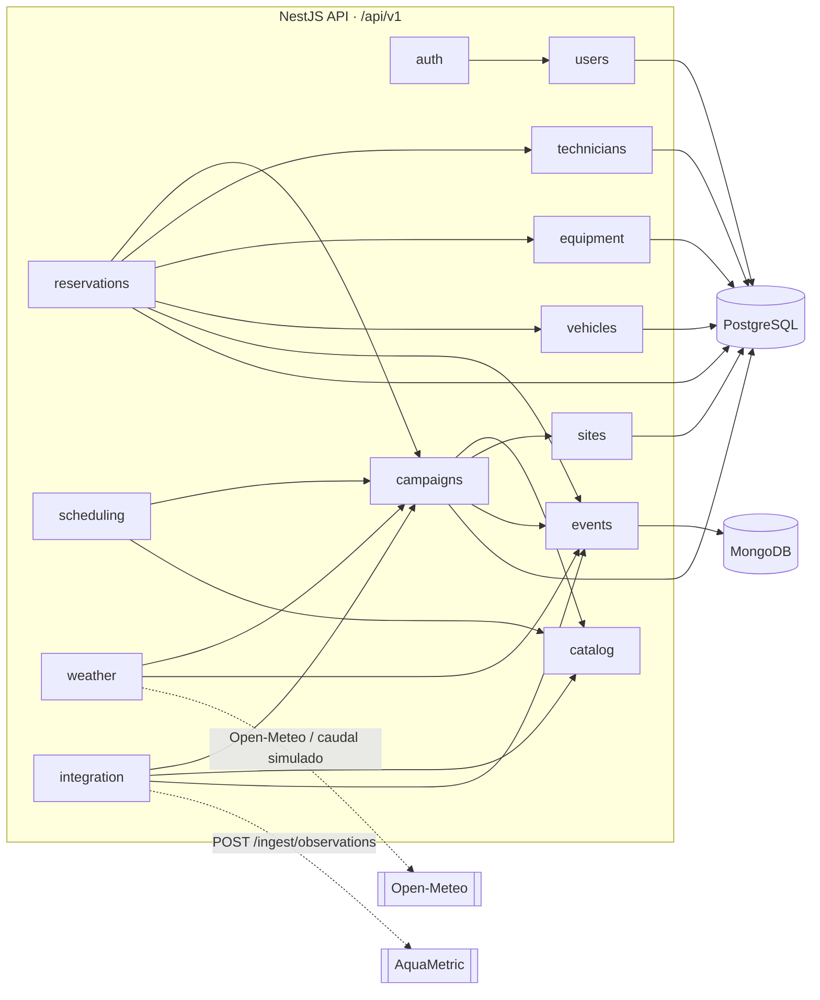
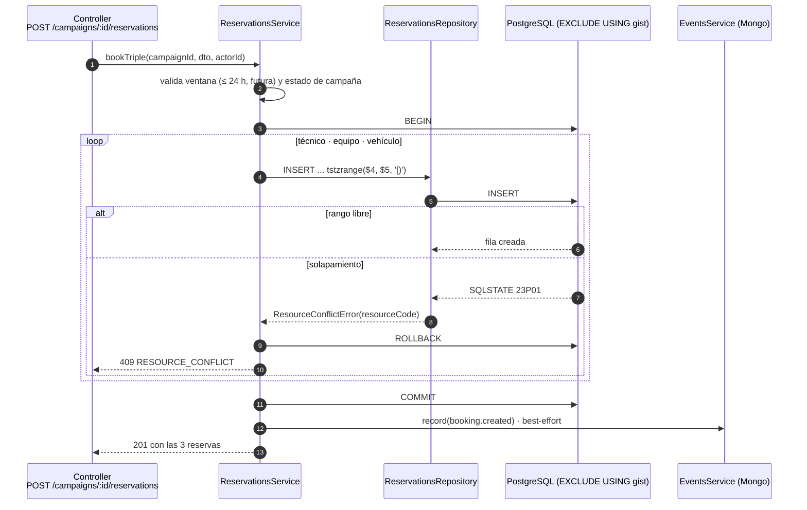
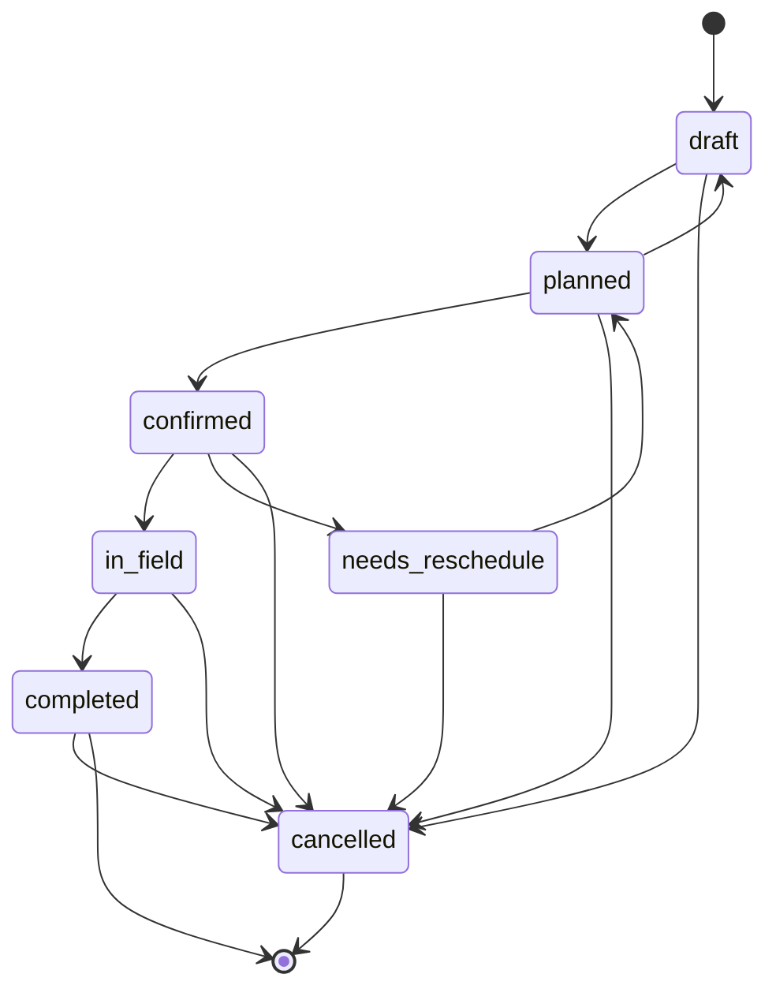
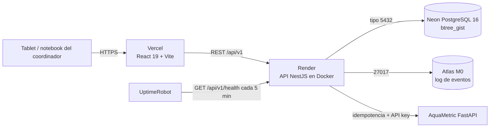

# Arquitectura de TerraPlan

Diagramas de referencia rápida. Las decisiones están justificadas en [`adr/`](adr/) y el glosario de
dominio en [`glossary.md`](glossary.md).

## 1. Módulos del backend

Dependencia unidireccional `Controller → Service → Repository → Entity/DB`. Un módulo exporta solo su
service; el dominio puro (`scheduling`, `weather`, `campaign-status`) no conoce Nest.

`scheduling` y `weather` llaman a `CampaignsService` para leer la campaña y sus parámetros; nunca
acceden a su repositorio. `reservations` es el único módulo que escribe `resource_booking`.

## 2. Flujo de reserva atómica

Los tres `INSERT` comparten una transacción: si uno viola la exclusion constraint, no queda ninguna
reserva parcial ([ADR-001](adr/001-atomic-booking.md)).

## 3. Ciclo de vida de la campaña

Las transiciones válidas viven en `campaign-status.domain.ts`; cualquier otra devuelve
`INVALID_STATE_TRANSITION` (409).

## 4. Despliegue (free tier)

Render free duerme el servicio tras ~15 min sin tráfico; el primer request puede tardar 30–50 s.
UptimeRobot mantiene el contenedor caliente. Pasos manuales en [`deploy.md`](deploy.md).
